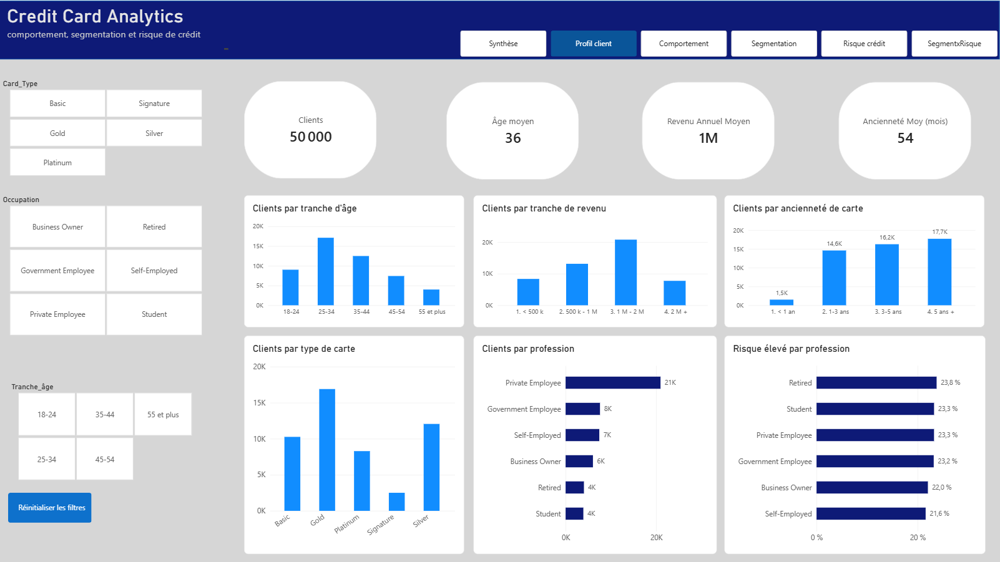
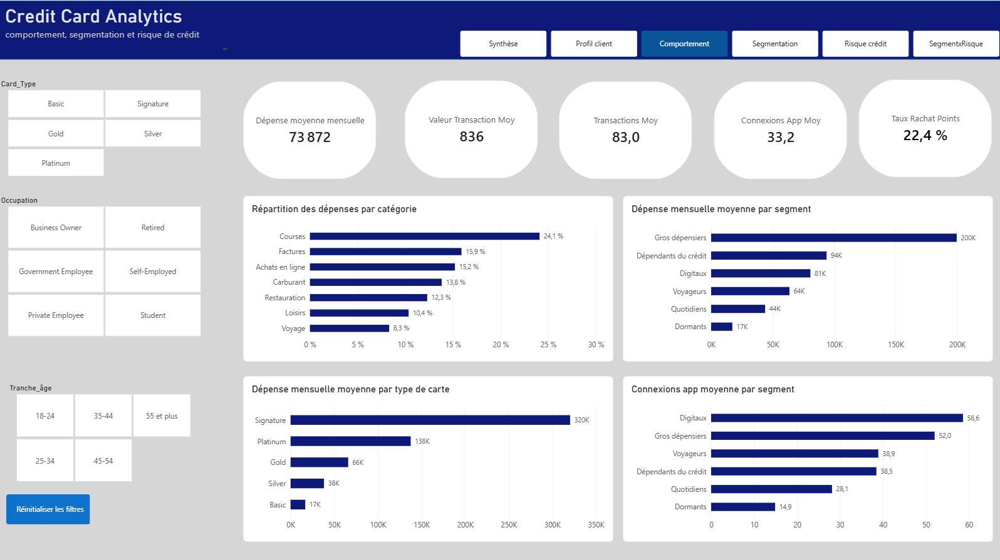
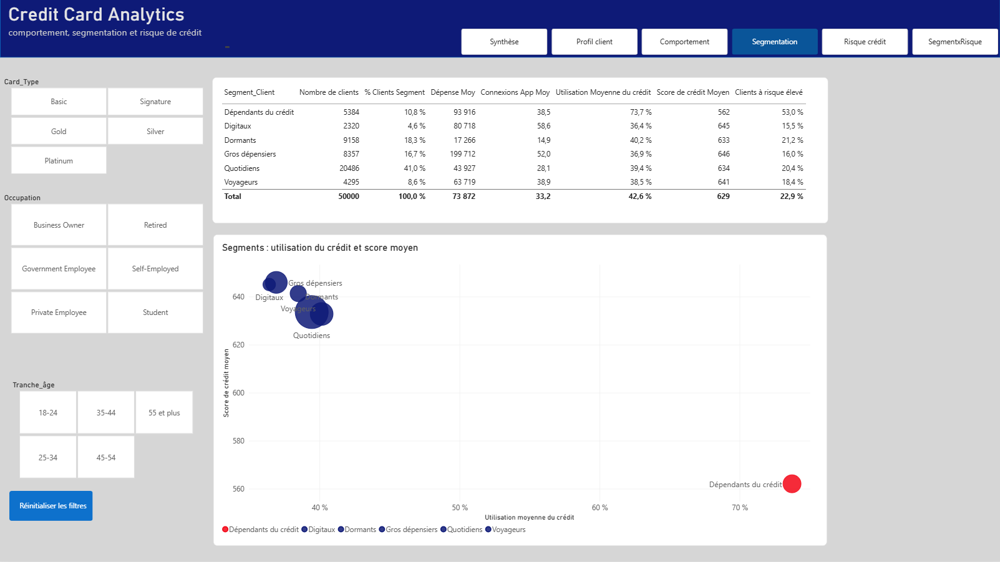
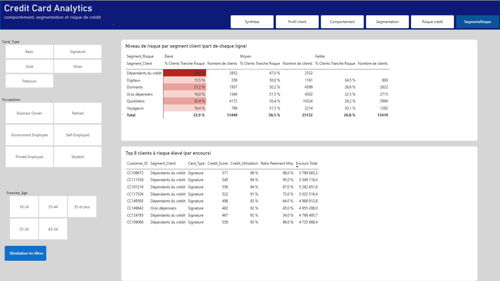

# 💳 Credit Card Risk Analytics — Détecter les clients à risque sur 50 000 porteurs de cartes

Dashboard Power BI d'analyse du **risque de crédit**, du **comportement** et de la **segmentation** de 50 000 clients porteurs de cartes de crédit.

## 🎯 Objectif

Aider un émetteur de cartes à :
- **repérer les clients à risque** avant qu'ils ne fassent défaut ;
- **comprendre les comportements** de dépense et de remboursement ;
- **segmenter la clientèle** pour adapter les plafonds, les offres et les actions de recouvrement.

## 📦 Les données

- **50 000 clients**, **30 variables**
- Profil client, dépenses, soldes, historique de paiements, score de crédit…
- Dataset synthétique public (Kaggle) : `synthetic_credit_card_customer_behavior_dataset.csv`

## 📊 Chiffres clés

| Indicateur | Valeur |
|---|---|
| Clients analysés | **50 000** |
| Score de crédit moyen | **629** |
| Utilisation moyenne du crédit | **42,6 %** |
| Clients à risque élevé | **22,9 %** (11 449 clients) |
| Encours total / encours à risque | **15,2 Md / 4,4 Md** |
| Taux d'avance cash | **29,7 %** |

## 💡 Principaux enseignements

1. **L'utilisation du crédit est le signal de risque le plus fort.** La part de clients à risque élevé passe de **8,2 %** chez ceux qui utilisent moins de 30 % de leur plafond à **41 %** entre 60 et 80 %, puis à **72,3 %** au-delà de 80 %. Au-dessus de 60 % d'utilisation, on ne trouve plus aucun client à risque faible.

2. **Les « Dépendants du crédit » concentrent le risque.** Ce segment ne pèse que **10,8 %** des clients, mais **53 %** d'entre eux sont à risque élevé, soit plus de deux fois la moyenne du portefeuille (22,9 %). **7 des 8 plus gros encours à risque** en font partie, tous sur cartes **Signature**, avec une utilisation du crédit de 83 à 94 %.

3. **Un portefeuille globalement fragile.** Près d'**un tiers de l'encours** (4,4 Md sur 15,2 Md) est porté par des clients à risque, et **68 %** des clients ont un score inférieur à 670 (faible ou moyen). Seuls **2 %** atteignent un très bon score (740+).

## 🗂️ Le dashboard (6 pages)

Chaque page peut être filtrée par type de carte, profession et tranche d'âge.

### 1. Synthèse
KPIs du portefeuille, répartition par niveau de risque et par segment client, risque par segment.

### 2. Profil client
Caractéristiques des porteurs de cartes.

### 3. Comportement
Habitudes de dépense et de remboursement.

### 4. Segmentation
Regroupement des clients en 6 segments : Quotidiens, Dormants, Gros dépensiers, Dépendants du crédit, Voyageurs, Digitaux.

### 5. Risque crédit
Encours total et à risque, niveau de risque selon l'utilisation du crédit, distribution des scores de crédit.

### 6. Segments × Risque
Matrice segment client × niveau de risque et top 8 des clients à risque élevé par encours.

## 🛠️ Démarche

- **Nettoyage et préparation** des données dans **Power Query**
- **Modélisation** et **mesures DAX** (indicateurs de risque, taux d'utilisation, segmentation)
- **Conception du dashboard** autour de trois axes : risque, comportement, segmentation

## 📁 Contenu du dépôt

| Fichier | Description |
|---|---|
| `credit_card_risk_analytics.pbix` | Fichier Power BI du dashboard |
| `synthetic_credit_card_customer_behavior_dataset.csv` | Données sources (50 000 lignes) |
| `*.png` | Captures des 6 pages |

## ▶️ Ouvrir le projet

1. Télécharger `credit_card_risk_analytics.pbix`
2. L'ouvrir avec [Power BI Desktop](https://powerbi.microsoft.com/desktop/) (gratuit)

## 🧰 Compétences mobilisées

`Power BI` · `Power Query` · `DAX` · `Analyse du risque de crédit` · `Segmentation client` · `Data visualization`

## 👤 Auteur

**Idris** — Master 2 MBA Finance Digitale, ISM Dakar
🔗 [GitHub](https://github.com/fofanaidris12) · [LinkedIn](https://www.linkedin.com/in/idris-fofana) · Actuellement à la recherche d'un stage en data / finance digitale
